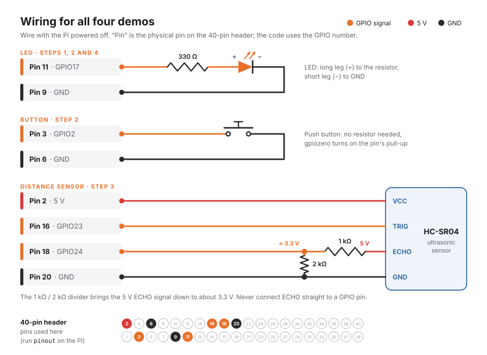

# Beyond the Laptop: Linux, Raspberry Pi and Physical Computing

[](https://github.com/sakar-rahulkatiyar/Beyond_the_laptop_session/actions/workflows/ci.yml)
[](LICENSE)
[](https://www.python.org/)

Demo code and guides from the one-hour session **Beyond the Laptop**, presented by Rahul Katiyar, Software Lead at [Sakar Robotics](https://www.sakarrobotics.com). In four short steps, a Raspberry Pi blinks an LED, reacts to a button, measures distance and takes commands from a phone. Together they build the same sense, think, act loop that runs every robot.



## What's inside

| Step | Run | What it shows | Slide |
| --- | --- | --- | --- |
| Terminal demo | `./scripts/hello.sh` | Files, permissions and `chmod +x` | 16 |
| 1. Blink an LED | `python3 demos/led.py` | Output: switching a GPIO pin | 22 |
| 2. Add a button | `python3 demos/button.py` | Input and events | 23 |
| 3. Read a distance sensor | `python3 demos/sensor.py` | The full sense, think, act loop | 24 |
| 4. Control it from your phone | `python3 demos/web.py` | A tiny IoT web server | 25 |

Guides:

- [Set up the Raspberry Pi](docs/setup.md): flash the card and connect over SSH, with no monitor or keyboard.
- [Wiring](docs/wiring.md): every connection, the voltage divider and the safety rules.
- [Command cheat sheet](docs/cheatsheet.md): the Linux commands from the terminal demo.
- [Troubleshooting](docs/troubleshooting.md): fixes for the problems people hit most.

## What you need

| Part | Qty | Notes |
| --- | --- | --- |
| Raspberry Pi 4 Model B or Raspberry Pi 5 | 1 | Any memory size works |
| microSD card | 1 | 16 GB or larger |
| USB-C power supply | 1 | Official supply recommended: 5.1 V 3 A for Pi 4, 5.1 V 5 A for Pi 5 |
| Breadboard and jumper wires | 1 set | Male-to-female wires reach the GPIO header |
| LED | 1 | Any colour |
| 330 Ω resistor | 1 | Limits the LED current |
| Push button | 1 | A four-leg tactile switch fits a breadboard |
| HC-SR04 ultrasonic distance sensor | 1 | |
| 1 kΩ and 2 kΩ resistors | 1 each | Voltage divider for the sensor's ECHO pin |

The demos should also work on other Raspberry Pi models with the 40-pin header.

## Safety first

1. **3.3 V only.** GPIO pins work at 3.3 V. Putting 5 V on a GPIO pin can permanently damage the Pi.
2. **Always use a resistor** in series with an LED, or the LED or the pin can burn out.
3. **Power off to rewire.** Run `sudo shutdown now` and unplug the Pi before you move wires.
4. **Divide the 5 V echo.** The HC-SR04's ECHO pin outputs 5 V. A 1 kΩ / 2 kΩ divider brings it down to about 3.3 V.

The [wiring guide](docs/wiring.md) explains each rule.

## Quick start

On the Raspberry Pi, set up as in [docs/setup.md](docs/setup.md):

```bash
sudo apt update
sudo apt install -y git python3-gpiozero python3-flask
git clone https://github.com/sakar-rahulkatiyar/Beyond_the_laptop_session.git
cd Beyond_the_laptop_session
```

Wire the circuit with the Pi powered off, then run each step. Press `Ctrl+C` to stop a demo.

```bash
python3 demos/led.py      # 1. the LED blinks once a second
python3 demos/button.py   # 2. each press toggles the LED
python3 demos/sensor.py   # 3. the LED turns on when your hand is closer than 20 cm
python3 demos/web.py      # 4. open http://<pi-ip>:5000/ on your phone
```

Find `<pi-ip>` with `hostname -I`. Every script accepts `--help`, and options such as `--interval`, `--threshold` and `--port` change its behaviour.

> **GPIO numbers are not pin numbers.** The code says `LED(17)`, which means GPIO17, but the wire goes to physical pin 11. Run `pinout` on the Pi to see the map.

## Project layout

```text
.
├── demos/                  The four GPIO demos, one self-contained script each
├── scripts/hello.sh        The first script from the terminal demo
├── docs/                   Setup, wiring, cheat sheet and troubleshooting guides
├── tests/                  Unit tests that run on any computer with mock GPIO pins
├── requirements.txt        Runtime dependencies, for pip installs
└── requirements-dev.txt    Test, lint and type-check tools
```

## Development

The tests use gpiozero's [mock pins](https://gpiozero.readthedocs.io/en/stable/api_pins.html#mock-pins), so they run on a laptop or in CI without a Raspberry Pi.

```bash
python3 -m venv .venv
source .venv/bin/activate
pip install -r requirements-dev.txt

pytest                    # unit tests
ruff check .              # lint
ruff format --check .     # formatting
mypy                      # type checks
shellcheck scripts/*.sh   # shell script checks
```

CI runs the same checks on every push and pull request. See [CONTRIBUTING.md](CONTRIBUTING.md) for the workflow.

## Keep learning

- [Raspberry Pi Projects](https://projects.raspberrypi.org): free step-by-step builds.
- [The Linux Command Line](https://linuxcommand.org): a free book by William Shotts.
- [OverTheWire: Bandit](https://overthewire.org/wargames/bandit/): learn the terminal as a game.
- [gpiozero documentation](https://gpiozero.readthedocs.io): every part used in these demos.

## License

Released under the [MIT License](LICENSE).

## About

Created by Rahul Katiyar, Software Lead at [Sakar Robotics](https://www.sakarrobotics.com), for the session *Beyond the Laptop: Linux, Raspberry Pi and Physical Computing*. Questions and improvements are welcome: open an [issue](https://github.com/sakar-rahulkatiyar/Beyond_the_laptop_session/issues) or read [CONTRIBUTING.md](CONTRIBUTING.md).
