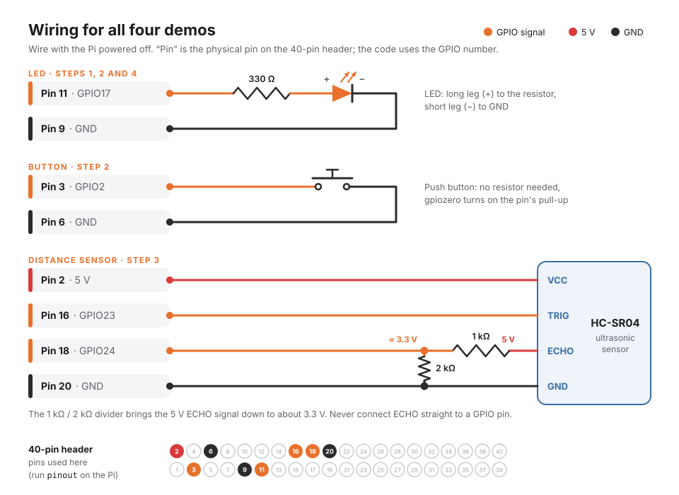

# Wiring

Wire everything with the Pi **powered off**. The tables use **physical pin numbers**, counted on the 40-pin header, and **GPIO numbers**, which the code uses. Run `pinout` on the Pi to see where each pin is.

## Safety rules

1. **3.3 V only.** GPIO pins work at 3.3 V. Putting 5 V on a GPIO pin can permanently damage the Pi.
2. **Always use a resistor.** A 330 Ω resistor in series with the LED limits the current. Without it, the LED or the pin can burn out.
3. **Power off to rewire.** Run `sudo shutdown now` and unplug the Pi before you move wires. A slipped jumper wire can short 5 V to ground.
4. **Divide the 5 V echo.** The HC-SR04's ECHO pin outputs 5 V. Never connect it straight to a GPIO pin.

Motors and relays never connect straight to a GPIO pin either: they need a driver board with its own power supply.

## LED and button (steps 1, 2 and 4)

| From | Pi pin | GPIO | In the code |
| --- | --- | --- | --- |
| LED long leg (+), through the 330 Ω resistor | Pin 11 | GPIO17 | `LED(17)` |
| LED short leg (−) | Pin 9 | GND | |
| Button, one leg | Pin 3 | GPIO2 | `Button(2)` |
| Button, other leg | Pin 6 | GND | |

The button needs no resistor: gpiozero turns on the pin's internal pull-up, so the pin reads high until the button connects it to ground.

## HC-SR04 distance sensor (step 3)

| Sensor pin | Pi pin | GPIO | In the code |
| --- | --- | --- | --- |
| VCC | Pin 2 | 5 V | |
| TRIG | Pin 16 | GPIO23 | `trigger=23` |
| ECHO | Pin 18, through the divider | GPIO24 | `echo=24` |
| GND | Pin 20 | GND | |

The sensor works like a bat: it sends an ultrasonic ping when TRIG goes high, then holds ECHO high until the echo comes back. gpiozero times that pulse and converts it to a distance.

### The voltage divider

ECHO outputs a 5 V pulse, but a GPIO pin takes at most 3.3 V. Two resistors bring it down:

- 1 kΩ from **ECHO** to **GPIO24** (pin 18)
- 2 kΩ from **GPIO24** to **GND**

The voltage at GPIO24 is 5 V × 2 kΩ ÷ (1 kΩ + 2 kΩ) ≈ 3.3 V.

## GPIO numbers and pin numbers

The code uses GPIO numbers, such as `LED(17)`. The wires go to physical pin numbers, such as pin 11. Most beginner bugs come from mixing the two up. When something doesn't work, check both against the tables above.

To use different pins, rewire and pass the new GPIO numbers to the script, for example `python3 demos/led.py --pin 27`. Run `python3 demos/<script>.py --help` to see each script's options.
